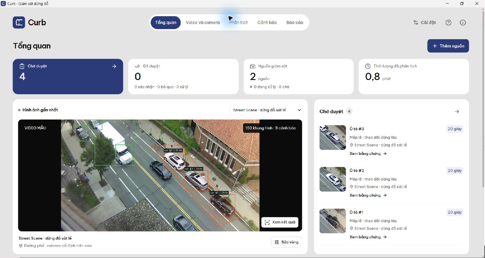

# Curb — giám sát dừng đỗ đường phố

[**Tải Curb cho Windows**](https://github.com/meiiie/tgmt-de7-illegal-parking/releases/latest) · [Hướng dẫn & hỗ trợ](SUPPORT.md) · [Lịch sử phiên bản](CHANGELOG.md) · [AGPL-3.0](LICENSE)



Ứng dụng Windows để quản lý video/camera, cấu hình vùng theo dõi, phát hiện phương tiện dừng lâu, duyệt bằng chứng và xuất hồ sơ. Giao diện tiếng Việt; video và dữ liệu được xử lý cục bộ trên máy.

Cảnh báo cần được người vận hành xem xét. Curb không tự kết luận vi phạm giao thông hoặc xử phạt. Bản hiện tại dành cho **một máy, một người vận hành, một nguồn suy luận tại một thời điểm**.

## Ứng dụng desktop Windows

Mở `Curb-Setup-1.1.0-x64.exe` và chờ màn hình tiến độ. Curb tự mở khi cài xong; lần sau mở từ Desktop hoặc Start menu. Không phải chọn thư mục hay bấm Next qua nhiều trang. Bộ cài kèm Python 3.12.10, PyTorch CPU, hai mô hình YOLO26, video mẫu, FFmpeg và giao diện đã build. Không cần terminal, Python hay Node riêng để sử dụng.

- Windows 10 x64 (1809+) / Windows 11; .NET Framework 4.8; Microsoft WebView2 và Visual C++ x64. Bộ cài tải các runtime còn thiếu từ Microsoft, nên trường hợp đó cần Internet; cài Visual C++ có thể hiện yêu cầu quyền quản trị của Windows.
- Dữ liệu desktop nằm tại `%USERPROFILE%/Curb/data`; tách khỏi thư mục cài. Gỡ ứng dụng giữ lại dữ liệu này.
- Vỏ WinForms/WebView2 tự bật dịch vụ trên một cổng loopback trống. Đóng cửa sổ dừng worker và dịch vụ. Windows Job Object thu hồi các tiến trình con khi host kết thúc.
- Bản desktop đi kèm **CPU**, chạy được khi không có NVIDIA. Bản phát triển dưới đây tiếp tục hỗ trợ CUDA. Các phép đo GPU trước đó không phải tốc độ của bộ cài CPU.
- Có hộp thoại lưu tệp Windows cho CSV/JSON/video/ZIP. Bản cài hiện chưa ký chứng thư nhà phát hành.
- Có thể chọn dữ liệu khác bằng tham số `--data-dir`. Thao tác này không tự di chuyển dữ liệu cũ.

Build lại: `./build-desktop.ps1` (cần `.venv`, Node, uv, .NET Framework compiler, Inno Setup 6.5+/7, model và video mẫu). Build dùng `%LOCALAPPDATA%/CurbBuild/cache`, khóa dependency tại `desktop/requirements-lock.txt`. Dùng `-SkipDependencies` khi runtime đã chuẩn bị.

Kiểm tra `SHA256SUMS.txt` trước khi phân phối lại. Bộ cài hiện chưa ký mã; checksum không thay thế chữ ký nhà phát hành.

Tài liệu gốc: [WinForms + WebView2 của Microsoft](https://learn.microsoft.com/en-us/microsoft-edge/webview2/get-started/winforms), [CPython embeddable](https://docs.python.org/3.12/using/windows.html#the-embeddable-package), [Inno Setup](https://jrsoftware.org/isinfo.php). Mã nguồn bản build và giấy phép được kèm trong bộ cài.

## Mở bản phát triển GPU / web

Sau khi chuẩn bị môi trường phát triển, mở `Start-Curb.cmd`, hoặc:

```powershell
.\run-curb.ps1
```

Địa chỉ mặc định: **http://127.0.0.1:8765/**. Một thư mục dữ liệu chỉ cho một phiên Curb sử dụng.

```powershell
# Build lại sau khi sửa giao diện
.\run-curb.ps1 -Build

# Chọn ổ lưu dữ liệu khác; không tự di chuyển dữ liệu cũ
.\run-curb.ps1 -DataDir 'D:\CurbData' -Port 8765

# Chạy dịch vụ mà không mở trình duyệt
.\run-curb.ps1 -NoBrowser
```

`Ctrl+C` trong cửa sổ chạy sẽ dừng ứng dụng và yêu cầu worker hoàn tất bằng chứng. Nếu ứng dụng bị đóng đột ngột, lượt đang chạy được đánh dấu gián đoạn ở lần mở tiếp theo.

## Các chức năng đã triển khai

| Luồng | Chức năng |
|---|---|
| Nguồn | Nhập MP4/MOV/MKV/AVI/WebM tối đa 1 GB; camera RTSP/RTSPS/HTTP(S); kiểm tra kết nối; ảnh xem trước; tên, địa điểm, ghi chú; lưu trữ và khôi phục nguồn |
| Vùng | Nhiều polygon, kiểm tra tự cắt/điểm trùng, kéo điểm hoặc sửa tọa độ; bật/tắt, loại xe, mức theo dõi, thời gian dừng |
| Theo giờ | Ngày trong tuần, khung giờ thường hoặc qua nửa đêm; video cần mốc ghi hình gốc, camera dùng giờ máy |
| Phân tích | YOLO26s hoặc YOLO26n + ByteTrack; GPU/CPU; hàng đợi bền vững; tiến độ và khung hình cập nhật; hủy; giới hạn thời lượng; khôi phục trạng thái sau gián đoạn |
| Bằng chứng | Ảnh toàn cảnh, ảnh phương tiện, clip trước/sau; H.264 có byte range; video toàn lượt cho tệp nhập; clip camera bám thời gian nguồn dù lấy mẫu không đều |
| Duyệt | Chờ duyệt / xác nhận / bỏ qua / đã xử lý; lưu và duyệt tiếp trong bộ lọc đang xem; lý do, tên người vận hành, lịch sử và chống ghi đè quyết định cũ |
| Báo cáo | Tìm kiếm, lọc nguồn/loại xe/trạng thái/ngày; phân trang; thống kê thực từ SQLite; xuất CSV/JSON và ZIP hồ sơ của từng lượt |
| Vận hành | Cài đặt, GPU/FFmpeg/model/dung lượng; nhật ký hệ thống; sao lưu SQLite và media; khôi phục sang thư mục mới; dọn thủ công dữ liệu hết hạn |

Tên người vận hành là nhãn lịch sử, **không phải tài khoản xác thực**. Dịch vụ chỉ bind loopback; không cung cấp chế độ LAN, Internet hoặc nhiều người dùng trong bản này.

## Chạy thử

1. Chọn **Thêm nguồn → Dùng video mẫu**. Nếu thiếu mẫu, chạy `scripts/download-demo.ps1` trước.
2. Mẫu Street Scene dài 30 giây có camera cố định, ba ô tô đỗ sát lề và phương tiện khác đi qua. Vùng theo dõi mép lề dùng ngưỡng 20 giây. Bấm **Chạy phân tích**.
3. Mở cảnh báo, xem ảnh và clip để đối chiếu xe dừng lâu. Quy định cấm đỗ của địa điểm chưa được xác minh; không dùng cảnh báo mẫu như bằng chứng xe vi phạm.
4. Với dữ liệu của bạn, chọn vùng phù hợp mặt đường và quy định của địa điểm, hiệu chỉnh ngưỡng bằng video phát triển rồi kiểm tra trên camera/video độc lập.

Nguồn mẫu: [MERL Street Scene — CC BY-SA 4.0](https://zenodo.org/records/10870472). Xem [ghi nguồn và biến đổi video](docs/demo-video-source.md). Mẫu Gaithersburg cũ vẫn được giữ để kiểm tra hồi quy; tải lại bằng `scripts/download-legacy-demo.ps1` khi cần.

## Chuẩn bị môi trường phát triển trên máy Windows khác

Cần Python 3.12 (uv có thể chuẩn bị), Node.js 22.12+ cho build, [uv](https://docs.astral.sh/uv/getting-started/installation/) và [FFmpeg](https://ffmpeg.org/download.html) trong PATH. Bản CUDA cần driver NVIDIA tương thích CUDA 12.6. Dành đủ dung lượng cho môi trường PyTorch, cache, video và bằng chứng; môi trường CUDA lớn hơn nhiều so với mã ứng dụng.

```powershell
.\setup-curb.ps1        # PyTorch CUDA 12.6, dependencies, frontend, model có kiểm tra SHA-256
# hoặc
.\setup-curb.ps1 -Cpu   # bản PyTorch CPU
.\scripts\download-demo.ps1
.\run-curb.ps1
```

Đã kiểm chứng tại máy này: Python 3.12.2; torch 2.11.0+cu126; ultralytics 8.4.184; OpenCV 4.12.0.88; FastAPI 0.162.0; React 19.3.1; TypeScript 5.9.3; Vite 8.3.6; GTX 1650 4 GB. Dependency frontend được khóa trong `web/package-lock.json`. Không cần Node khi frontend đã build và chỉ chạy ứng dụng.

## Dữ liệu và khôi phục

Bản phát triển mặc định `outputs/curb/`; desktop dùng `%USERPROFILE%/Curb/data`:

- `curb.sqlite3`: nguồn, vùng, công việc, sự kiện, lịch sử duyệt và cài đặt.
- `uploads/`: bản video đã nhập.
- `sources/`: ảnh khung hình để vẽ vùng.
- `jobs/<id>/`: ảnh, clip, video toàn lượt, `manifest.json` và `metrics.json`.

Manifest ghi snapshot cấu hình, commit nền, hash mã Python/model/video, môi trường, seed và thiết bị. Metrics ghi số frame, thời gian model/toàn lượt, số cảnh báo, số frame có ùn xe và VRAM tensor đỉnh. Không có huấn luyện hoặc phép đo độ chính xác độc lập trong lượt xây ứng dụng.

Trong **Cài đặt → Sao lưu**, dừng các công việc rồi tải ZIP. Bản desktop có nút **Khôi phục bản sao lưu…** để chọn ZIP, tạo thư mục mới và mở lại với dữ liệu khôi phục. Dữ liệu cũ được giữ nguyên. Địa chỉ và mật khẩu camera **không có trong bản sao lưu**; cần nhập lại sau khi khôi phục. SQLite của phiên vận hành có chứa thông tin kết nối camera và chưa mã hóa trên đĩa; bảo vệ tài khoản Windows/thư mục dữ liệu tương ứng.

```powershell
# Chỉ nhận thư mục đích chưa tồn tại, không ghi đè dữ liệu
.venv/Scripts/python.exe -m curb.backup 'D:\Backups\curb-backup.zip' --destination 'D:\CurbRestored'
.\run-curb.ps1 -DataDir 'D:\CurbRestored'
```

Thời hạn lưu trữ chỉ tạo danh sách đề xuất dọn, không tự xóa. Nút dọn xóa hồ sơ/bằng chứng của lượt hết hạn sau xác nhận trong giao diện; nguồn và video đã nhập được giữ lại. Hãy sao lưu trước khi dọn.

## Kiểm tra phát triển

```powershell
.venv/Scripts/python.exe -m unittest discover -s tests -v
npm --prefix web run build
uv pip check --python .venv/Scripts/python.exe

# Khi Curb đang chạy: upload và inference thật, HTTP camera phát lại,
# cancel/disconnect, media decode/range, review, export và backup.
.venv/Scripts/python.exe -X utf8 scripts/verify_curb.py
```

Script tích hợp tạo nguồn có tiền tố `[Kiểm thử]`, rồi lưu trữ chúng sau khi chạy; giữ lịch sử và bằng chứng để truy vết. Đây là kiểm thử vận hành bằng clip mẫu, không phải đánh giá camera hiện trường.

Xem [kiểm chứng bản phát hành 1.1.0](docs/release-verification-1.1.0.md), [báo cáo web/GPU ban đầu](docs/rebuild-verification-2026-11-08.md) và [kiểm chứng desktop CPU ban đầu](docs/desktop-verification-2026-11-08.md). Giao diện Windows được kiểm tra trực tiếp trong cửa sổ ứng dụng. Mobile chưa được kiểm tra.

## Kiến trúc và giới hạn triển khai

React/TypeScript được build và phục vụ cùng origin bởi FastAPI. SQLite WAL giữ dữ liệu. Mỗi công việc chạy trong tiến trình Python riêng; bộ điều phối cho một worker GPU hoạt động. Engine thời gian dừng là mô-đun thuần Python, tách khỏi detector và giao diện.

Bản desktop Windows dùng WebView2 và CPU; bản web phát triển hỗ trợ CUDA. Khả năng xử lý thực tế phụ thuộc camera, độ phân giải, nhịp lấy mẫu và phần cứng. Camera HTTP phát lại đã được kiểm tra; chưa có địa chỉ RTSP hiện trường để thử. Chưa có OCR biển số, phân quyền nhiều người, triển khai Internet hay cam kết vận hành 24/7. Chưa kiểm tra độc lập mưa, đêm, camera rung, che khuất và mật độ đường phố Việt Nam.

Mã ứng dụng Curb được phát hành theo **AGPL-3.0-only**, phù hợp nhánh mã mở của [Ultralytics](https://www.ultralytics.com/license). Các thành phần bên thứ ba giữ giấy phép riêng; xem [thông báo thành phần](desktop/THIRD-PARTY-NOTICES.md). Mẫu MERL và các bản phái sinh giữ CC BY-SA 4.0. FFmpeg 7.1.1 của Gyan dùng GPLv3; nguồn tương ứng được kèm trong bộ cài và release.

Các nguyên tắc pstack đã áp dụng: **Model the Domain** (Source/Job/Stop/Event riêng, snapshot bất biến); **Sequence Verifiable Units** (engine → API → suy luận → frontend); **Prove It Works** (chạy thật, giải mã media và ghi kết quả). Tự thực hiện và tự review, không dùng subagent.

## Bản nghiên cứu được giữ nguyên

Demo Gradio: `run.ps1`; pipeline cũ: `src/pipeline.py`; evaluator cũ: `src/evaluate.py`. Các notebook và `results/` lịch sử vẫn giữ nguyên. Chúng không dùng engine mới của Curb và còn các giới hạn được ghi trong [phân tích baseline](docs/preparation-2026-11-06.md).

[Tài liệu nghiên cứu gốc](README-research.md) · [Hướng sản phẩm](PRODUCT.md) · [Hướng giao diện](DESIGN.md) · [Kế hoạch kiến trúc](docs/rebuild-plan.md)
