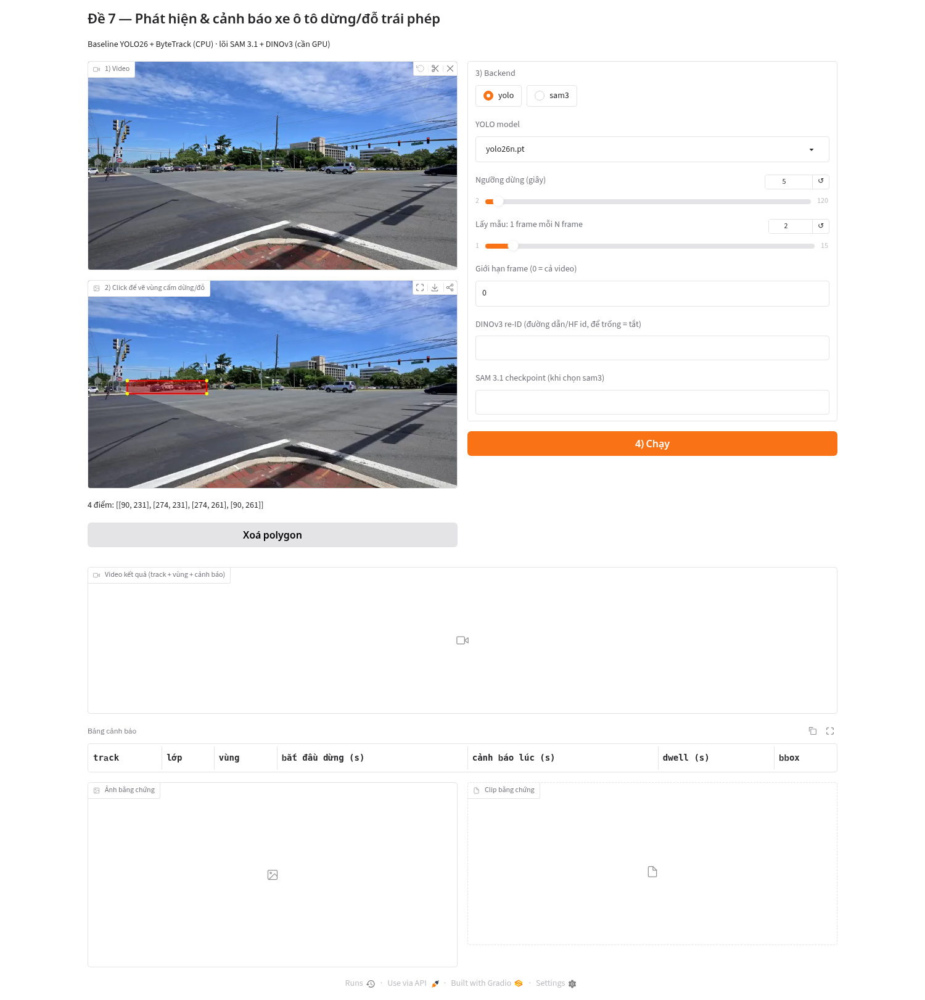
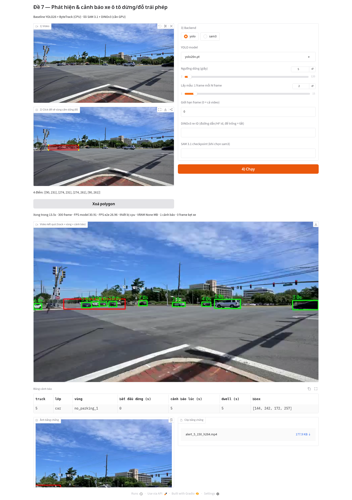

# Đề 7 - Phát hiện và cảnh báo ô tô dừng đỗ trái phép (SAM 3.1 + DINOv3)

Học phần Thị giác máy tính nâng cao.

## Demo Gradio (`app.py`)
Tải video → click các đỉnh polygon vùng cấm dừng/đỗ trên khung hình đầu → chọn backend → Chạy. Kết quả: video có track/vùng/cảnh báo, bảng cảnh báo (thời điểm bắt đầu dừng, thời điểm cảnh báo, dwell), ảnh và clip bằng chứng.

### Chạy local (CPU, baseline YOLO26 + ByteTrack)
```bash
python3.12 -m venv .venv && . .venv/bin/activate
pip install ultralytics lap gradio opencv-python "transformers>=4.56"   # ffmpeg cần có trong PATH
python app.py            # mở http://127.0.0.1:7860
```
### Colab
```python
!git clone https://github.com/meiiie/tgmt-de7-illegal-parking.git && %cd tgmt-de7-illegal-parking
!pip -q install ultralytics lap gradio "transformers>=4.56"
!pip -q install "git+https://github.com/facebookresearch/sam3.git@7f473cf"   # chỉ khi dùng backend sam3 (GPU)
!python app.py --share    # in ra link *.gradio.live
```
### Kaggle (GPU T4, Internet ON)
Thêm dataset `holilihu/de7-weights` (SAM 3.1 + DINOv3), ghép checkpoint: `cat /kaggle/input/**/sam31_part_* > weights/sam3.1_multiplex.pt`, rồi `python app.py --share` và điền đường dẫn checkpoint ở ô "SAM 3.1 checkpoint". Không cần HF token.

Ảnh chụp thật (chạy CPU):




## Kết quả (AIC21 Track 4, mức sự kiện)

9 video (7 sự kiện), 2 fps, cả khung hình là vùng, dwell 20 s, khớp nếu cảnh báo nằm trong [bắt đầu dừng, kết thúc + 30 s], gộp cảnh báo trùng IoU ≥ 0.3. GPU Kaggle T4.

| Cấu hình | P | R | F1 | FPS e2e | VRAM đỉnh |
|---|---|---|---|---|---|
| YOLO26s + ByteTrack (baseline) | 0.40 | 0.57 | 0.471 | 34.2 | 100 MB |
| YOLO26s + ByteTrack + DINOv3 re-ID | – | – | 0.435 | 33.6 | 175 MB |
| SAM 3.1 (+ DINOv3) | xem bảng v4 | | | | |

Số đo SAM 3.1 đã có (v3, clip Gaithersburg 480p, stride 3, 658 frame, bf16 autocast + attention fp16): **0.18 FPS**, VRAM đỉnh **10.5 GB** (10.6 GB có DINOv3), 0 cảnh báo (đúng, clip không có xe đỗ). v3 hết ngân sách thời gian trước khi chạy AIC21 nên chưa có P/R/F1.

Kernel v4 (`kaggle/kernel_v4/`, tạo bằng `notebooks/make_nb_v4.py`): fp16, prompt `car`, 1 fps, 240 s đầu của video 9/33/35/7, cạnh dài 640 px, chunk 60, sanity 5 frame (0 box → dừng), ngân sách 100 phút, baseline chạy lại trên cùng cửa sổ, tất cả gộp vào `out/de7_v4_results.json`.

### Kernel v4 (T4, fp16, 240 s đầu video 9/33/35/7, 1 fps, 640 px, 4 sự kiện; cùng eval)

Sanity 5 frame prompt `car`: 33 box, VRAM 7.9 GB → đạt. Tổng 4934 s.

| Cấu hình | P | R | F1 | FPS e2e | VRAM đỉnh |
|---|---|---|---|---|---|
| YOLO26s + ByteTrack | 1.0 | 0.75 | 0.857 | 13.315 | 66.1 MB |
| YOLO26s + ByteTrack + DINOv3 | 0.8 | 1.0 | 0.889 | 14.076 | 145.2 MB |
| SAM 3.1 fp16 | 0.0 | 0.0 | 0.0 | 0.482 | 7862.3 MB |
| SAM 3.1 fp16 + DINOv3 | 0.0 | 0.0 | 0.0 | 0.481 | 7985.8 MB |

SAM 3.1: 0 cảnh báo trên cả 4 video (0 jam frame, 0 re-ID merge) dù detector ra box → lỗi nằm ở khâu track/dwell với output SAM (nghi: ID đổi giữa các chunk 60 frame hoặc box dao động vượt `still_tol`), chưa kiểm chứng. Cửa sổ ngắn, 4 sự kiện → số baseline v4 không so trực tiếp với bảng 9 video.

### Kernel v5 (T4): baseline 9 video chạy lại + chẩn đoán SAM 3.1

9 video AIC21 (7 sự kiện), 2 fps, dwell 20 s, pipeline hiện tại (gộp trùng IoU 0.3 và bỏ box < 200 px² ngay trong pipeline):

| Cấu hình | P | R | F1 | FPS e2e | VRAM đỉnh |
|---|---|---|---|---|---|
| YOLO26s + ByteTrack | 0.444 | 0.571 | 0.500 | 34.3 | 100 MB |
| YOLO26s + ByteTrack + DINOv3 | 0.333 | 0.571 | 0.421 | 33.1 | 175 MB |

SAM 3.1 fp16, video 35, 240 s đầu, 1 fps, 640 px, chunk 60, max_objects 8 (sanity: 40 box / 5 frame, 7.86 GB):

| Biến thể | FPS e2e | VRAM | ID gốc → ID cuối | Dòng đứng yên | Dwell max | Cảnh báo |
|---|---|---|---|---|---|---|
| Không nối ID | 0.55 | 7.86 GB | 32 → 32 | 3 / 738 | 3 s | 0 (F1 0) |
| Nối ID IoU + DINOv3 | 0.54 | 7.99 GB | 32 → 31 (1 lần nối) | 3 / 738 | 3 s | 0 (F1 0) |

Kết luận: giả thuyết "ID đổi ở ranh giới chunk" **bị bác bỏ**. Các track dài nhất là xe đang chạy (tâm box dịch 100–230 px) và rất nhỏ (cao 8–22 px); chỉ 165/240 frame có box, trung bình 4.5 box/frame. Xe dừng của sự kiện có vẻ không được SAM 3.1 bám ở 640 px với giới hạn 8 đối tượng (suy luận từ dump, chưa kiểm chứng trực quan). Hướng tiếp: giữ độ phân giải gốc, tăng `max_objects`, hoặc dùng YOLO đề xuất box làm prompt cho SAM 3.1. Dump: `results/v5_tracks/`.

## Công nghệ và license

| Thành phần | Phiên bản | License | Nguồn |
|---|---|---|---|
| SAM 3.1 (detect/segment/track theo text) | `facebook/sam3.1`, repo sam3 @7f473cf | SAM License (Meta, tùy chỉnh; HF gated) | https://github.com/facebookresearch/sam3/blob/main/LICENSE , https://huggingface.co/facebook/sam3.1 |
| DINOv3 ViT-S/16 (re-ID) | `facebook/dinov3-vits16-pretrain-lvd1689m` | DINOv3 License (Meta, tùy chỉnh; HF gated) | https://github.com/facebookresearch/dinov3/blob/main/LICENSE.md , https://huggingface.co/facebook/dinov3-vits16-pretrain-lvd1689m |
| YOLO26n/s + ByteTrack/BoT-SORT (baseline) | Ultralytics 8.4.184 | AGPL-3.0 | https://github.com/ultralytics/ultralytics/blob/main/LICENSE |
| BoxMOT | – | AGPL-3.0 | https://github.com/mikel-brostrom/boxmot/blob/master/LICENSE |
| Transformers | ≥ 4.56 | Apache-2.0 | https://github.com/huggingface/transformers/blob/main/LICENSE |
| PyTorch | 2.11 | BSD-3-Clause | https://github.com/pytorch/pytorch/blob/main/LICENSE |
| OpenCV | 4.x | Apache-2.0 | https://github.com/opencv/opencv/blob/4.x/LICENSE |
| Gradio | – | Apache-2.0 | https://github.com/gradio-app/gradio/blob/main/LICENSE |
| AI City Challenge 2021 Track 4 | train set | Tải công khai; điều khoản dùng theo trang AI City (chưa kiểm chứng điều khoản cụ thể) | https://www.aicitychallenge.org/ai-city-challenge-dataset-access/ |
| Clip Gaithersburg MD-355/MD-124 (Wikimedia) | 480p | CC BY 4.0, G. Edward Johnson | https://commons.wikimedia.org/wiki/File:MD-355_and_MD-124_Gaithersburg_MD_2022-07-30_11-07-03_1.webm |

Lưu ý: dùng Ultralytics/BoxMOT (AGPL-3.0) trong sản phẩm đóng cần license thương mại; SAM/DINOv3 theo điều khoản riêng của Meta.
