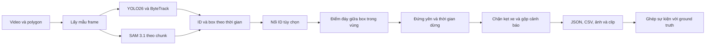

# Cơ sở cải thiện dự án phát hiện dừng đỗ

Mục tiêu của lượt này là clone, hiểu dự án và chuẩn bị các thay đổi có thể kiểm chứng. Đã hoàn thành phân tích cùng bộ tái hiện cục bộ. Mã sản phẩm, dữ liệu lịch sử và các cấu hình thực nghiệm chưa thay đổi.

Khuyến nghị giữ YOLO26s + ByteTrack làm đối chứng. Ưu tiên vòng đời sự kiện, phép đánh giá và khả năng chạy lại trước khi tăng độ phức tạp mô hình. Bằng chứng hiện có chưa cho thấy SAM 3.1 hoặc DINOv3 giúp bản chính tốt hơn.

## Phiên bản và phạm vi đã kiểm tra

- Nguồn là [meiiie/tgmt-de7-illegal-parking](https://github.com/meiiie/tgmt-de7-illegal-parking).
- Clone tại `E:/Sach/Sua/ThayTuan/tgmt-de7-illegal-parking`, nhánh `main`.
- Commit gốc là `10f94e8a3c93a4b4654653b246ae9875c91250d1`.
- Đã đọc toàn bộ hai tệp lõi, ứng dụng Gradio, cấu hình AIC21, tài liệu trạng thái và bộ tạo notebook v5, v6.
- Đã đối chiếu các kết quả JSON, CSV và tính lại thống kê từ bốn tệp track SAM.
- Đã kiểm tra cú pháp 9 tệp Python được Git theo dõi. Cả 9 đạt.
- Chưa chạy detector, tracker, SAM, DINOv3, huấn luyện hoặc giao diện trong lượt này.
- Không commit, push, mở dịch vụ công khai hoặc chạy GPU cloud.

## Cách hệ thống hoạt động



Các khái niệm cần tách biệt là ID tracker, một lần dừng và một cảnh báo. Cùng một xe có thể dừng nhiều lần. Một lần dừng có thể đi qua nhiều ID khi bị che khuất. IoU giống nhau tại hai thời điểm không đủ để kết luận đó là cùng một sự kiện.

| Tệp | Vai trò hiện tại |
|---|---|
| `src/pipeline.py` | Đọc video, hai backend, nối ID, đứng yên, vùng, dwell, kẹt xe, cảnh báo và thống kê |
| `src/evaluate.py` | Lọc cảnh báo rồi ghép tham lam theo video, vùng và khoảng thời gian |
| `app.py` | Upload video, vẽ polygon, gọi pipeline bằng subprocess, đổi video sang H.264 |
| `configs/zones_aic_full.json` | Cả khung hình là một vùng, dwell 20 giây, cửa sổ đứng yên 3 giây |
| `notebooks/make_nb_v5.py`, `make_nb_v6.py` | Nhúng mã nguồn vào notebook Kaggle và chạy các thử nghiệm |
| `results/` | Bảng kết quả, báo cáo v4 đến v6 và track SAM đã lưu |

Mã chưa có lớp `DwellEngine` dù một docstring dùng tên này. Logic thời gian nằm trong `main()`. Vì vậy không nên lập kế hoạch dựa trên tên lớp trong mô tả cũ.

## Kết quả lịch sử nói được điều gì

Các số dưới đây đọc từ artifact của repo, không phải số đo mới trên máy Windows.

| Thử nghiệm | Phạm vi | P | R | F1 | FPS được báo cáo |
|---|---|---|---|---|---|
| v5 YOLO26s + ByteTrack | 9 video, 7 sự kiện, lấy mẫu 2 FPS | 0,444 | 0,571 | 0,500 | 34,30 |
| v5 thêm DINOv3 | Cùng 9 video | 0,333 | 0,571 | 0,421 | 33,08 |
| v6 YOLO26s + ByteTrack | 240 giây đầu của 9 video, 5 sự kiện, lấy mẫu 1 FPS | 1,000 | 0,600 | 0,750 | 23,13 |
| v6 SAM text + box | 240 giây đầu của 8 video, thiếu video 62 | 0 | 0 | 0 | 0,463 |

Nguồn là [v5](../results/de7_v5_results.json), [v6](../results/de7_v6_results.json) và [bảng tổng hợp](../results/aic21_table.csv). Không dùng F1 0,750 của cửa sổ v6 để tuyên bố cải thiện từ F1 0,500 của video đầy đủ. Phạm vi và tần suất lấy mẫu khác nhau. SAM v6 cũng chưa chạy cùng toàn bộ video với YOLO.

Tính lại bốn tệp track cho kết quả khớp báo cáo.

| Tệp track | Số dòng | Frame có detection | ID cuối | Dòng đứng yên | Dwell lớn nhất |
|---|---:|---:|---:|---:|---:|
| v5 không stitch | 738 | 165 | 32 | 3 | 3 giây |
| v5 stitch + DINOv3 | 738 | 165 | 31 | 3 | 3 giây |
| v6 text 800 px, 32 object | 5.340 | 236 | 128 | 54 | 4 giây |
| v6 text + box | 4.529 | 220 | 131 | 43 | 4 giây |

Các dump này chứng minh lịch sử pipeline đã ghi rất ít quan sát đứng yên. Chúng không tự chứng minh vì sao SAM bỏ xe mục tiêu. Chưa kiểm tra trực quan video gốc trong lượt này. Việc stitch không cứu được thử nghiệm v35 làm yếu giả thuyết ranh giới chunk là nguyên nhân chính trong cấu hình đó; chưa đủ để bác bỏ mọi vấn đề ID ở các cảnh khác.

[AI City 2021 Track 4](https://www.aicitychallenge.org/2021-challenge-tracks/) đánh giá bất thường giao thông, gồm tai nạn và xe bị dừng trên đường. Đây không phải bộ nhãn chuyên biệt cho đỗ xe trái phép trong vùng cấm. Cấu hình ROI toàn khung hiện chỉ cung cấp đối chứng phát hiện xe dừng.

`STATUS.md` ghi rõ `min_area` đã được chọn sau khi xem kết quả trên cùng 7 sự kiện. Vì vậy tập 9 video hiện tại phù hợp làm tập phát triển và kiểm tra hồi quy. Nó chưa phải test độc lập cho các cải thiện tiếp theo. Repo cũng chưa lưu đủ raw alerts của baseline v5 để chấm lại toàn bộ bằng một evaluator khác chỉ từ bản clone.

## Các vấn đề đã tái hiện

[Script kiểm tra](../scripts/inspect_baseline.py) chạy `pipeline.main()` thật với video đen và box, ID được định trước. Nó thay backend mô hình bằng nguồn detection tổng hợp. Hai ca cơ sở đạt; bảy kỳ vọng chưa đạt. Hai kỳ vọng trong số đó là yêu cầu mạnh hơn thiết kế hiện tại, không phải lỗi vi phạm đặc tả cũ.

| Ưu tiên | Vấn đề | Bằng chứng cục bộ | Vị trí |
|---|---|---|---|
| P1 | Xe ra khỏi vùng nhưng còn giữ timer và vùng cũ | Điểm đáy giữa chuyển từ x=31 sang x=33, vượt biên x=32. Vẫn phát cảnh báo ở giây 4 | `pipeline.py` dòng 290 đến 298, 320 |
| P1 | Gộp cảnh báo không có giới hạn vòng đời sự kiện | Hai xe dừng cùng vị trí ở giây 0 và 11, có khoảng trống 5 giây. Chỉ nhận 1 cảnh báo thay vì 2 | `pipeline.py` dòng 316 đến 320 |
| P1 | Bộ lọc đánh giá gộp hai sự kiện cách nhau 100 giây | Cùng bbox và video làm mất sự kiện thứ hai | `evaluate.py` dòng 13 đến 19 |
| P1 | Bộ lọc đánh giá không phân biệt vùng | Hai cảnh báo thuộc hai vùng khác nhau còn 1 | `evaluate.py` dòng 18 |
| P2 | Video không đọc được vẫn có thể kết thúc như thành công | Với backend tổng hợp dùng bộ đọc frame thật, `main()` trả bình thường và ghi 0 frame | `pipeline.py` dòng 14 đến 22, 238, 342 đến 352 |
| Thiết kế đánh giá | Chấm đúng thời điểm nhưng sai xe vẫn được tính TP | Hai bbox hoàn toàn không giao nhau vẫn nhận TP=1 | `evaluate.py` dòng 21 đến 27 |
| Thiết kế chuyển động | So sánh hai đầu cửa sổ bỏ qua chuyển động giữa cửa sổ | Quỹ đạo x=0, 100, 0 bị coi đứng yên | `Track.stationary`, dòng 205 đến 209 |

Kỳ vọng ghép đúng không gian là đề xuất nâng chất lượng evaluator. Ground truth lịch sử không có bbox; không được tự thêm bbox giả để chấm lại. Ca quay về điểm đầu cũng là phép thử giới hạn thiết kế, chưa phải thống kê lỗi trên video thực tế.

[Kết quả chạy đầy đủ](baseline-probes-2026-11-06.json) chứa commit, hash mã, môi trường, từng đầu vào mô tả và đầu ra. Các ảnh, clip tổng hợp nằm trong thư mục `outputs/baseline-inspection-5f98c2cf`. Chúng chỉ minh họa logic, không minh họa khả năng nhận diện xe.

## Rủi ro thấy từ mã nhưng chưa chạy xác nhận

- Tỉ lệ kẹt xe tính trên mọi detection trong khung, không riêng từng làn hoặc vùng. Hàng xe chờ ngoài vùng có thể chặn một cảnh báo bên lề. Cần một ca video kiểm chứng.
- `app.py` mặc định YOLO26n và dwell 5 giây, khác bản chính YOLO26s, dwell 20 giây trong báo cáo. Giao diện còn gọi SAM là lõi và truyền BF16, trong khi v4 đến v6 ghi FP16.
- `metrics.json` ghi `amp` theo tùy chọn chung. YOLO lại nhận `half` riêng. Vì vậy trường `amp=fp16` không đủ chứng minh YOLO đã chạy FP16.
- FPS pipeline tính từ lúc bắt đầu backend đến cuối vòng lặp. Việc nạp DINOv3 xảy ra trước mốc này; chuyển H.264 trong ứng dụng xảy ra sau. Chưa có thời gian đầy đủ từ lúc người dùng bấm chạy đến lúc xem kết quả.
- Chưa có manifest dependency, lockfile, test suite hoặc CI trong commit gốc. Hướng dẫn cài package chưa pin nên chưa tái tạo được môi trường chỉ bằng một lệnh ổn định.
- Notebook v6 nhúng đúng hai tệp lõi hiện tại. v4 và v5 nhúng phiên bản pipeline khác. Đây là snapshot lịch sử; không ghi đè chúng khi chuẩn bị lần chạy mới.
- `plan.md` vẫn mô tả SAM là lõi và một số mục chưa có trong mã, như overlap chunk, kiểm tra tỉ lệ mask trong ROI, dual-background và resume theo chunk. Cần tách ý tưởng khỏi chức năng hiện có trong tài liệu tiếp theo.

## Thứ tự cải thiện được đề xuất

Đây là backlog có điều kiện nghiệm thu, chưa phải các thay đổi đã thực hiện. Không đặt mục tiêu tăng F1 trước khi cố định giao thức và có dữ liệu tương ứng.

| Đợt | Thay đổi nhỏ nhất | Bằng chứng để hoàn thành | Phụ thuộc |
|---|---|---|---|
| A | Tạo môi trường Python riêng, dependency manifest và lệnh chạy Windows. Giữ checkpoint YOLO26s với hash. Ghi cấu hình baseline đầy đủ | Chạy được một video có quyền sử dụng; mở video kết quả, ảnh và clip; ghi chính xác phiên bản và lệnh | Có video và trọng số phù hợp |
| B | Sửa reset timer khi ra vùng. Phân biệt kết thúc một lần dừng với đổi ID. Gộp theo vùng và cùng lần dừng | Hai ca cơ sở vẫn đạt; ra vùng không báo; dừng lần hai có cảnh báo; che khuất ngắn không sinh bản sao; kiểm tra trên clip thật | A cho kiểm tra video; ca tổng hợp có thể làm ngay |
| C | Đóng băng evaluator cũ để so sánh lịch sử. Thêm giao thức sự kiện có vị trí khi dữ liệu có nhãn đó. Tạo manifest chia theo camera hoặc video | Chấm một-một, có ca sai xe, trùng ID, hai sự kiện cùng chỗ; không giao nguồn giữa tập phát triển và test; ngưỡng cố định trước test | B và dữ liệu được gán nhãn |
| D | Đồng bộ lựa chọn mặc định trong app. Thử tối ưu từng biến trên cùng dữ liệu và phần cứng | Báo cáo từng tình huống, FP mỗi giờ, độ trễ cảnh báo, thời gian toàn ứng dụng và tài nguyên; video trình diễn có bằng chứng đúng | A, B, C |

Đợt B chỉ cần chỉnh logic và thêm kiểm tra hành vi. Chưa cần chia pipeline thành nhiều service. Nếu tách mã, chỉ tách phần quy tắc sự kiện đủ để kiểm thử, giữ adapter mô hình và giao diện hiện có.

Dữ liệu tương lai cần phân biệt dừng bị cấm theo cấu hình vùng, dừng hợp lệ, chờ đèn, kẹt xe, che khuất, xe bị cắt ở biên và xe nhỏ. Cần ghi cả thời điểm vào vùng, bắt đầu dừng, rời vùng và kết thúc sự kiện. Với camera mới, kiểm tra thiết lập ROI trước khi chấm.

Sau khi có baseline đáng tin, thử riêng từng thay đổi như tần suất lấy mẫu, độ phân giải, ngưỡng đứng yên hoặc tracker. DINOv3 chỉ được đưa vào cấu hình chính nếu giảm lỗi trên tập phát triển và giữ được lợi ích trên test. SAM nên bắt đầu bằng một clip mục tiêu ngắn có kiểm tra box và thời gian, không lặp lại toàn bộ đợt Kaggle trước khi hiểu lỗi hiện tại.

TensorRT, TTA và ensemble là các lựa chọn sau đó. Kết quả tốt của bài khẩu trang hoặc bài truy vấn ảnh trước đây không chứng minh chúng tốt cho bài này. Với phép đo tốc độ, ghi nguồn điện, warmup, phần cứng, thời gian nạp model, giải mã, xử lý, ghi video và chuyển H.264. Các lượt so sánh phải dùng cùng clip và cấu hình đầu ra.

## Cách làm việc kế thừa từ các phiên trước

Đã đọc các lượt gần đây trong hai chat `Đánh giá dự án nhận diện khẩu trang` và `Khảo sát dự án học tiếng Trung`, cùng các AGENTS của ThayTuan, NekoBot và ThucChienAI. Chỉ kế thừa cách làm việc, không chuyển kiến trúc hoặc ràng buộc cuộc thi sang repo này.

- Giữ dự án riêng và tài liệu rõ để tiếp tục được ở lượt sau.
- Giữ kết quả cơ sở; đo cùng dữ liệu trước khi tuyên bố nhanh hoặc chính xác hơn.
- Tách rõ tính năng đã chạy, tính năng mới viết và hướng chưa triển khai.
- Kiểm tra luồng sử dụng thực tế sau kiểm tra mã. Giới hạn kết luận theo phần đã quan sát.
- Tự thực hiện, không dùng subagent. Công việc tối ưu bài truy vấn ảnh đã được yêu cầu tạm dừng ở chat cũ không được tự khởi động lại.

Áp dụng adapter pstack phiên bản 0.15.36, upstream commit `bb68f2365eceafa0cb2d253112f675acf5f144cc`, theo luồng Investigation và `how`.

| Nguyên tắc đã đọc | Quyết định cụ thể trong lượt này |
|---|---|
| Prove It Works | Tái hiện bằng `pipeline.main()` và evaluator thật, không chỉ suy luận từ mã |
| Build the Lever | Lưu `scripts/inspect_baseline.py` để người sau chạy lại |
| Laziness Protocol | Giữ mã sản phẩm và baseline, ưu tiên sửa hai lỗi sự kiện thay cho viết lại kiến trúc |
| Sequence work into verifiable units | Mỗi đợt A đến D có đầu ra và điều kiện kiểm chứng riêng |
| Model the Domain | Phân biệt ID tracker và lần dừng khi xác định hợp đồng cần sửa |

Checklist Investigation được thực hiện tuần tự bởi một agent.

- [x] Route through the **how** skill. For motivation questions, also route through the **why** skill. `why` không cần cho yêu cầu khảo sát này.
- [x] Throughput checkpoint stays one line: `throughput checkpoint: n/a, read-only investigation`.
- [x] Produce the `how`-shaped output (Overview / Key Concepts / How It Works / Where Things Live / Gotchas), or a recommendation with a tradeoffs table if the request is a decision between alternatives. Các phần tương ứng nằm trong báo cáo này.
- [x] Apply the **unslop** skill to the reply. Tài liệu cũng dùng `technical-writing`.

Phần đọc mã là read-only. Các tệp mới chỉ phục vụ chuẩn bị và kiểm chứng. Các bước giao việc của upstream được thay bằng tự khám phá và tự review theo adapter và chỉ thị trực tiếp của người dùng.

## Chạy lại phép kiểm tra cục bộ

Môi trường đã chạy là Python 3.13.7, NumPy 2.3.2, OpenCV 4.13.0.92 và Torch 2.12.0+cpu trên Windows. Đây không phải môi trường T4 của báo cáo lịch sử. Python toàn cục thiếu Ultralytics, Gradio và lap; lượt này không cài thêm hoặc đổi môi trường của các dự án khác.

```powershell
cd E:\Sach\Sua\ThayTuan\tgmt-de7-illegal-parking
python -X utf8 scripts/inspect_baseline.py --output outputs/baseline-probes.json
```

Ở commit gốc, đầu ra tổng hợp là `total=9, met=2, unmet=7`, mã thoát 1. Mã 1 ở đây biểu thị các yêu cầu chưa đạt, không phải lượt kiểm tra thành công toàn bộ. Sau khi sửa, chạy lại vào tệp mới; giữ JSON ngày 06/11 làm bằng chứng trước sửa.

Phép kiểm tra không tải mô hình, không gọi API và không cần video riêng tư. Nó không chứng minh độ chính xác detector, độ bền tracker, FPS thực tế hoặc tính dễ dùng của Gradio.
