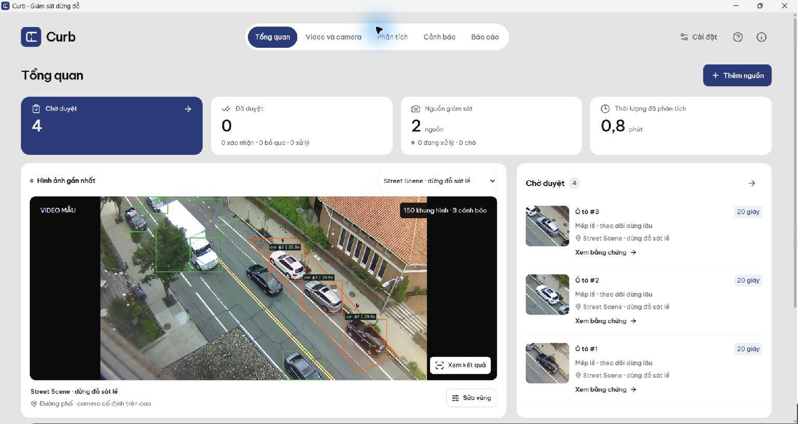
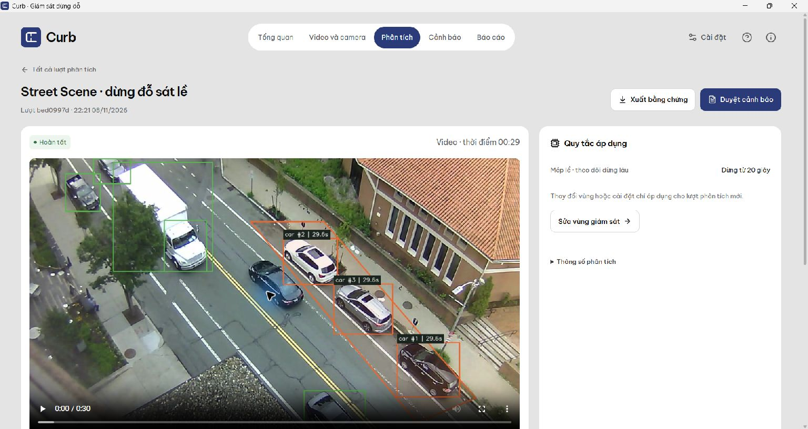
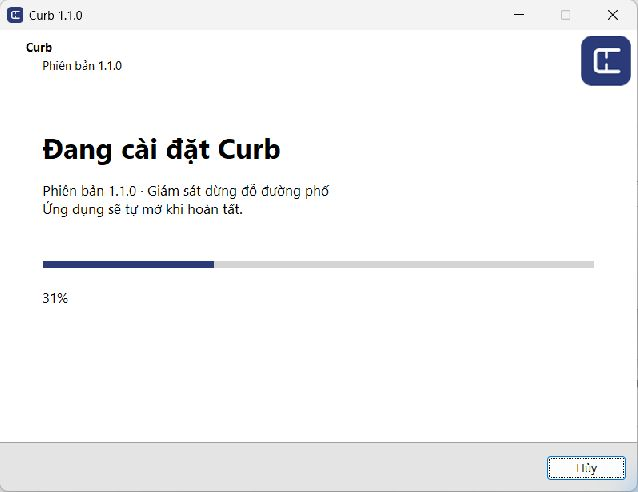
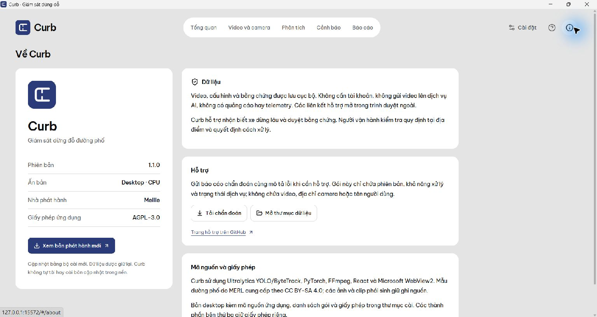

# Curb 1.1.0 — kiểm chứng bản phát hành

Kiểm thử trên Windows ngày 08–09/11/2026, tự thực hiện; không có huấn luyện hoặc đánh giá độ chính xác độc lập. Commit nguồn của gói phát hành được ghi trong `release-manifest.json` và tag `v1.1.0`. Nền nghiên cứu trước thay đổi: `10f94e8a3c93a4b4654653b246ae9875c91250d1`.

## Kết quả đã quan sát

| Phạm vi | Kết quả |
|---|---|
| Logic/API/media | 33/33 unittest đạt; gồm polygon, lịch qua đêm, ùn xe, vòng đời lần dừng, review conflict, backup/restore, khóa dữ liệu và chẩn đoán không lộ thông tin nguồn |
| Frontend | TypeScript và Vite production build đạt; kiểm tra đồng nhất phiên bản đạt |
| Tích hợp thật | 24/24 kiểm tra đạt trên runtime desktop CPU: upload, phân tích, giải mã H.264, byte range, review/export, video hỏng, HTTP camera replay, hủy, mất kết nối và sao lưu |
| Native UI | Dùng mẫu → chạy CPU → 150 frame, 3 cảnh báo; mở ảnh/clip, duyệt kèm lý do; khôi phục ZIP sang thư mục mới và ứng dụng tự mở lại |
| Tải tệp | Hộp thoại Save As của Windows lưu JSON chẩn đoán 1.1.0; popup Downloads của WebView2 đã được loại bỏ |
| Nâng cấp | Từ 1.0.1 lên 1.1.0, tự mở ứng dụng; giữ nguyên 2 nguồn, 2 lượt, 4 sự kiện và 0 lượt duyệt của dữ liệu trước nâng cấp |
| Gỡ ứng dụng | Uninstaller kết thúc mã 0, xóa executable và giữ nguyên cơ sở dữ liệu cùng các số lượng trên |
| Cài lại | Quick Install cài vào `%LOCALAPPDATA%/Programs/Curb`, tự mở và đọc lại 2 nguồn, 2 lượt, 4 sự kiện cũ; không cần bấm Next/Install |
| ZIP không hợp lệ | CLI từ chối với mã 1 và thông báo lỗi; không tạo thư mục đích, không ghi đè dữ liệu |
| Dependency | `uv pip check` xác nhận 52 gói runtime tương thích; `npm audit` báo 0 advisory ở thời điểm kiểm tra, không thay thế rà soát bảo mật độc lập |
| Nhận diện | Logo vector, biểu tượng Windows, phiên bản, nhà phát hành Meiiie, About và thông báo giấy phép thống nhất |
| Luồng UX mới | Duyệt và mở hồ sơ tiếp theo; lọc riêng một mã rồi duyệt xong quay lại danh sách, hồ sơ ngoài bộ lọc vẫn chờ duyệt. Sửa điểm vùng bằng bàn phím làm khóa nút chạy và hiện lý do; lưu vùng mở lại nút chạy |
| Chữ và bố cục | Kiểm tra cửa sổ 1090×735 và 1536×816, zoom 100%; phát hiện và sửa tràn thanh điều hướng khi phóng to 200%, kiểm tra lại không còn tràn. WebView2 dùng vi-VN, bộ chọn ngày hiện thứ tự ngày/tháng/năm và nhãn tiếng Việt. Thẻ Chờ duyệt mở đúng bộ lọc |
| Quick Install mới | Biên dịch và cài thành công, mã thoát 0, không yêu cầu khởi động lại trên máy có đủ runtime. Đã quan sát thanh tiến độ Abyss Blue tăng từ 23% đến 31%; không có bước Next/Install |

Rà soát nội dung dựa trên [tài liệu Apple, Google và Microsoft](ux-writing.md). Đã bỏ điều hướng lặp, lời dẫn không giúp thao tác và chuyển thông số kỹ thuật vào mục mở rộng. Bản production frontend và 33 unittest đạt sau thay đổi. Bộ quét Impeccable chỉ chạy quy tắc regex trên 12 tệp; không phải kiểm tra DOM hoặc chứng nhận khả năng truy cập. Chưa có thử nghiệm khả dụng với người dùng độc lập.

Ảnh chụp từ cửa sổ thực tế, zoom 100%:









## Hồi quy che khuất

Video MERL Street Scene Test006 dài 60 giây, SHA-256 `697b61f38c556d102b999437393ccbff4907682c40b8204da27261f02ff55932`. Camera cố định, ba xe sát lề; xe tải che khuất ở khoảng giây 35–38. Mẫu 30 giây trong ứng dụng dùng SHA-256 `218ec991f1cf3133244736c35a02ddd69a6708753c903354331ea7a42a00d99e`.

Đối chiếu engine 1.0.1 và 1.1.0 trên **cùng detections**, YOLO26s, ByteTrack, 5 FPS, ảnh 640, seed 0, float32; ROI và ngưỡng 20 giây lấy từ `curb/demo.json`. Engine cũ tạo 6 cảnh báo, engine mới tạo 3 lần dừng với ba track khác nhau. Unit test kiểm tra thêm chuyển vị trí thật, rời vùng, mất dấu dài, xe mới và che khuất trước khi đủ thời gian dừng.

Lượt GPU GTX 1650: 300 frame, 2.091 quan sát detection, 20,500 giây toàn lượt, 9,991 giây model. Đây là phép đo một lượt phát triển, không phải benchmark tăng tốc. Bản cài Windows dùng CPU; không dùng số GPU để quảng cáo tốc độ bộ cài.

Lượt bằng Python và mã của ứng dụng đã cài: CPU, 300 frame, 2.091 quan sát detection, 6 → 3 cảnh báo; toàn lượt 70,719 giây, model 54,153 giây, 4,242 frame lấy mẫu/giây. Quá trình build diễn ra cùng lúc; số này là quan sát chức năng và độ trễ tại máy phát triển, không phải phép đo hiệu năng được cô lập. Hash engine đối chứng: `4bd78e02ee233315e51d14a1efa3a6805156174454083e35684ad2b0d7f27bc2`.

Các frame Test001–Test006 đã được xem khi chọn mẫu. Chúng không độc lập với quá trình phát triển và không chứng minh độ chính xác trên đường phố Việt Nam. [Bằng chứng hồi quy đã loại thông tin đường dẫn](release-evidence-1.1.0.json) ghi hash mã/model/video, môi trường và kết quả. Giữ nguyên báo cáo lịch sử; lưu báo cáo mới dưới `outputs/release-1.1.0/` ở máy phát triển. Không đưa dữ liệu vận hành hoặc log thô vào Git.

## Môi trường và tái hiện

- Desktop: CPython 3.12.10, PyTorch 2.11.0+cpu, Ultralytics 8.4.184, FFmpeg 7.1.1, WebView2 SDK 1.0.4314.35. Danh sách 52 gói Python nằm trong asset dependencies và `desktop/requirements-lock.txt`.
- Phát triển GPU: CPython 3.12.2, PyTorch 2.11.0+cu126, GTX 1650 4 GB.
- Frontend: React 19.3.1, TypeScript 5.9.3, Vite 8.3.6; dependency khóa bằng `web/package-lock.json`.
- Ghi source/model/video SHA-256, seed, cấu hình và môi trường trong manifest của từng job. Kết quả này không thay thế đánh giá chia tập theo camera/video độc lập.

```powershell
.venv/Scripts/python.exe -X utf8 -m unittest discover -s tests -v
npm --prefix web run build
.venv/Scripts/python.exe scripts/sync_version.py --check

# Dịch vụ đang chạy, dữ liệu kiểm thử riêng:
.venv/Scripts/python.exe -X utf8 scripts/verify_curb.py --base-url http://127.0.0.1:<port> --report outputs/integration.json

# Hồi quy 60 giây bằng Python của bản desktop đã cài:
<app>/runtime/python.exe -X utf8 scripts/verify_occlusion.py --app-root <app> --video <Test006-60s.mp4> --data-dir <new-test-directory> --device cpu --output outputs/occlusion-cpu.json

.venv/Scripts/python.exe scripts/check_release.py
./build-desktop.ps1
.venv/Scripts/python.exe scripts/release_manifest.py --build-root "$env:LOCALAPPDATA/CurbBuild/cache"
```

## Giới hạn còn lại

[GitHub Actions run 42498742221](https://github.com/meiiie/tgmt-de7-illegal-parking/actions/runs/42498742221) không khởi chạy job do GitHub báo tài khoản bị khóa vì vấn đề billing. Cả hai job không thực thi bước nào; không gọi CI là đạt. Các kết quả logic/API/frontend ở trên được chạy cục bộ. Workflow giữ trong repo để chạy lại khi tài khoản được mở; workflow build Windows trên runner sạch chưa được thực thi.

Chưa thử camera RTSP vật lý, mạng hiện trường, hoạt động liên tục 24/7, nhiều loại camera/mưa/đêm/rung hoặc hiệu quả theo lớp trên tập độc lập. HTTP camera replay chỉ kiểm tra luồng vận hành. Chưa kiểm tra mobile. Trường hợp máy thiếu WebView2/.NET/Visual C++ chưa được tái hiện trên máy Windows sạch; bộ cài có kiểm tra và hướng dẫn tương ứng.

Rà soát DLL xác nhận `c10.dll`, `torch_cpu.dll` và `torch_python.dll` cần `MSVCP140.dll`; máy thử có Visual C++ 14.44.35211. Bộ cài kiểm tra runtime x64 v14.44+ và tải bản 14.51.36247.0 từ URL Microsoft cố định khi thiếu, kiểm tra SHA-256 `843068991daaa1f73ad9f6239bce4d0f6a07a51f18c37ea2a867e9beca71295c`. Đã tải tệp và xác minh chữ ký Microsoft; chưa gỡ runtime dùng chung để giả lập máy thiếu thành phần. Cài runtime có thể cần UAC, không tự khởi động lại Windows. Đối chiếu [hướng dẫn triển khai của Microsoft](https://learn.microsoft.com/en-us/cpp/windows/latest-supported-vc-redist).

Chưa có chứng thư ký mã; không tuyên bố tránh được SmartScreen. Một người vận hành, một worker tại một thời điểm; không có OCR biển số, nhận diện danh tính, phân quyền nhiều người hay xử phạt tự động. Cần chạy thử và đánh giá tại địa điểm triển khai trước khi dựa vào cảnh báo để vận hành thực tế.
