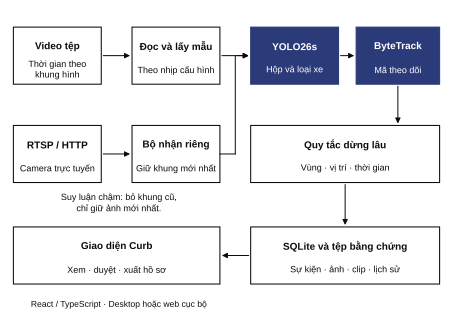

# Báo cáo xây dựng ứng dụng Curb

[**Tải báo cáo Word**](Curb-report.docx) · [Mã nguồn](../../README.md) · [Bộ cài Windows](https://github.com/meiiie/tgmt-de7-illegal-parking/releases/latest)

Báo cáo 36 trang, ba chương, không có phụ lục:

1. Tổng quan bài toán và phương pháp.
2. Thiết kế và xây dựng ứng dụng Curb.
3. Thực nghiệm và đánh giá.

Bản báo cáo theo mẫu trình bày đã cung cấp: khổ A4, lề trái 3 cm, phải 2 cm,
trên/dưới 2,5 cm; thân bài Times New Roman 14, giãn dòng 1,5. Có mục lục tự
động, danh mục hình/bảng, 11 hình và bảy bảng nội dung. Các ảnh chụp kết quả
AI City và camera YouTube thuộc lượt chạy thật ngày 14/11/2026.

Số liệu được phân biệt theo phần cứng, phạm vi dữ liệu và mục đích phép thử.
GTX 1650 thuộc bản nguồn CUDA; bộ cài Windows 1.1.0 dùng CPU. AI City là tập
phát triển theo bộ chấm của đề tài; các lượt camera kiểm tra tiếp nhận và vận
hành, chưa đánh giá độ chính xác bằng nhãn độc lập.

## Sơ đồ và biểu đồ

Các hình được vẽ theo hướng dẫn Scientific Figure Making của
[figures4papers](https://github.com/ChenLiu-1996/figures4papers), sử dụng bộ màu
Abyss Blue, Void Eclipse và Silver Mist. Tệp SVG giữ chữ và đường nét vector.

- [Vòng đời một lần dừng](figures/01-stop-lifecycle.svg).
- [Kiến trúc xử lý của Curb](figures/02-curb-architecture.svg).
- [Quy trình giám sát và duyệt cảnh báo](figures/03-review-workflow.svg).
- [Nhịp xử lý các nguồn camera](figures/04-camera-throughput.svg).

## Tài liệu đối chiếu

- [Dữ liệu AI City, cách chạy và kết quả](../realtime-and-aicity-2026-11-14.md).
- [Lượt RTSP, HTTPS/HLS và YouTube qua API Curb](../curb-camera-and-report-2026-11-14.md).
- [Kết quả nghiên cứu và vai trò DINOv3](../../README-research.md).

Video dữ liệu, trọng số mô hình, địa chỉ camera vận hành và cơ sở dữ liệu cá
nhân không được đưa vào kho mã. Liên kết nguồn dữ liệu và hướng dẫn chuẩn bị
môi trường nằm trong tài liệu dự án.
